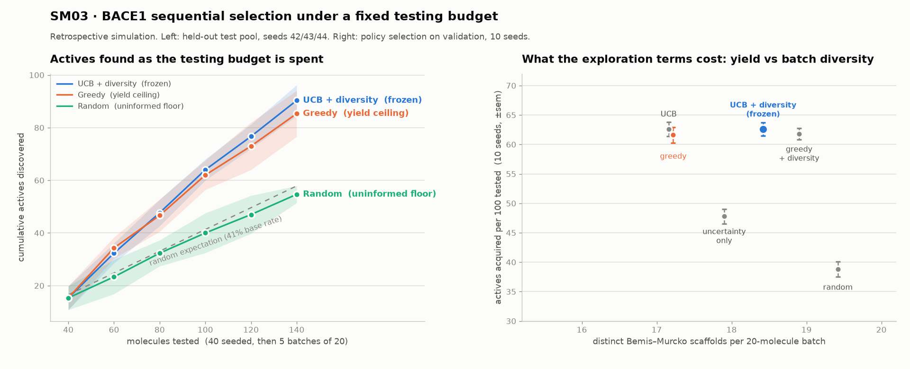

# Choosing What to Test

**SciSprint 2026 · Molecule Masters · SM03 — BACE1 sequential selection under a fixed testing budget**

You have 1513 candidate BACE1 inhibitors and budget to assay 140 of them. Which
140? And how do you choose the next 20 knowing only what the previous 20 told
you?

This repository is a retrospective simulation of that campaign, built with
[Boltzmann Labs' Agent Scientist](https://github.com/boltzmannlabs/agent-scientist).

---

## Headline

Held-out test pool (375 compounds, 155 active, 41.3% base rate), 140 molecules
tested, averaged over the prescribed seeds 42/43/44:

| policy | actives acquired per 100 tested | sd |
|---|---|---|
| **UCB + diversity** (frozen before testing) | **73.0** | 2.65 |
| greedy exploitation | 70.0 | 3.00 |
| random selection | 39.3 | 4.93 |

**1.9× better than testing at random**, and it holds across the whole campaign,
not just at the end:

| molecules tested | 40 | 60 | 80 | 100 | 120 | 140 |
|---|---|---|---|---|---|---|
| UCB + diversity | 15.3 | 32.0 | 48.3 | 64.3 | 79.0 | **88.3** |
| greedy | 15.3 | 34.3 | 47.3 | 63.7 | 73.3 | 85.3 |
| random | 15.3 | 23.3 | 32.3 | 40.0 | 47.0 | 54.7 |

## The finding we think matters more

The policy was frozen on validation before any test label was revealed. Over
**ten** validation seeds with paired *t*-tests, the honest answer is that the
exploitation-driven policies are **indistinguishable from each other**:

| policy | acquired (10 seeds) | ±sem | scaffolds per batch | paired *t* vs greedy |
|---|---|---|---|---|
| UCB | 63.1 | 1.59 | 17.2 | p = 0.45 |
| greedy | 62.5 | 1.13 | 17.1 | — |
| **UCB + diversity** (frozen) | 61.6 | 1.06 | **18.5** | p = 0.31 |
| greedy + diversity | 60.9 | 0.87 | **18.9** | p = 0.21 |
| uncertainty only | 48.9 | 1.06 | 17.8 | p < 0.001 |
| random | 38.8 | 1.27 | 19.4 | p < 0.001 |

Note what this does and does not say. The frozen policy is not the highest mean
on validation — UCB is, by 1.5 actives, which the paired test says is noise. The
sophistication **bought no yield**. What it bought was **1.4 more distinct
Bemis–Murcko scaffolds per 20-molecule batch at no significant cost**, and on the
test pool that gap widened to **17.1 scaffolds against greedy's 15.0**. Free
diversity is worth taking. That is a different and much weaker claim than "our
method wins", and it is the one the data supports.

Note also where uncertainty-only lands. That is essentially the acquisition rule
of Wen, Li, Xiang & Reker (*Digital Discovery* 2023, **2**, 1134), who select the
molecule nearest the decision boundary and show it beats training on full data.
It is 13.6 actives behind greedy here, p < 0.001. Not a contradiction — they
optimise **model performance**, this task scores **discovery yield**, and the
optimal acquisition rule differs.

## A third thing

Ranking our final 20 recommendations purely on predicted activity returned only
**12 distinct scaffolds across 20 slots** — the model was quietly recommending
near-duplicates and would have wasted nearly half the testing capacity.
Filtering at Tanimoto 0.70 brings it to 18/20, and drops mean pairwise
similarity from 0.227 to 0.171.



---

## How it works

The hard part of this problem is not the model. It is proving you did not cheat.
Any model that can see the full label column solves the task trivially, so
labels live behind a reveal interface that enforces the protocol **in code**:

```
src/oracle.py      RevealOracle — the ONLY path from a compound ID to its label
src/data.py        loading, leakage guards, scaffold-separated pools
src/features.py    ECFP4 (2048 bit, r=2) + 16 physchem descriptors, from SMILES
src/models.py      random forest; uncertainty = disagreement between trees
src/policies.py    the acquisition ladder, random → UCB + diversity
src/simulate.py    the campaign driver
```

`RevealOracle` refuses a second initial reveal, a re-query of an already-tested
molecule, a batch of the wrong size, a request missing its predictions, an ID
outside the pool, and any batch past the fifth. `scripts/smoke_test.py` asserts
all six. Every round is appended to a ledger recording the ordered compound IDs
**and the model's predictions before the labels came back**. Those ledgers are in
`outputs/*_ledgers/` and are the audit trail for every number above.

Three design choices worth naming:

- **Descriptors are recomputed from SMILES.** The source file ships ~590
  precomputed descriptor columns next to `pIC50` and `Class`; we touch none of
  them, so there is no question about whether a source column encodes the label.
- **The model is refit from scratch each round**, never updated, so a round's
  predictions depend only on labels legitimately revealed before it.
- **Batches are built sequentially with a similarity penalty.** Taking the top
  20 by score independently is the classic error: the model cannot update
  mid-round, so the 20 top-scoring molecules are often near neighbours and the
  batch carries about one molecule of information.

## Reproducing

Requires Python 3.10+. Fetch the dataset first (not redistributed here — see
`data/README.md` for the URL and checksums), then from the directory **above**
this one:

```bash
pip install -r sm03/requirements.txt
python -I sm03/scripts/smoke_test.py                       # protocol guards
python -I sm03/scripts/sweep_validation.py sm03/data/bace.csv
python -I sm03/scripts/resolve_tie.py      sm03/data/bace.csv
python -I sm03/scripts/run_test.py         sm03/data/bace.csv
python -I sm03/scripts/make_figures.py
```

Run `smoke_test.py` first: it asserts that each of the six protocol violations is
actually refused, and prints the scaffold count, which is the canary for the
environment problem below.

**Numbers will shift by a few actives across environments.** Scaffold perception
and the random forest both depend on RDKit and scikit-learn versions, and the
scaffold grouping determines the pool split. The tables above were produced on
Python 3.13 / Windows. The *ranking* and the *significance conclusions* are what
must reproduce, not the third significant figure.

`RUNBOOK.md` has the Agent Scientist prompt sequence used to drive the audit, the
runs and the interpretation.

## Limitations, stated plainly

- **This is a retrospective simulation on published activity data, not
  prospective discovery.** Every "discovered" active was already labelled in the
  source file.
- **The final 20 are model predictions, not measured activities.** They are
  reported with their nearest-labelled-neighbour Tanimoto so a reader can see
  which rest on extrapolation. In the reported run, all 20 fall inside the
  applicability domain.
- **The frozen policy was not the validation winner.** It was selected on the
  three prescribed seeds, then found statistically tied with three alternatives
  over ten seeds, and kept for its diversity advantage rather than its mean. It
  happened to come out 3 actives ahead on test; with three seeds, that gap is
  itself inside the noise.
- **The pool partition is ours, not the organisers'.** The brief specifies
  scaffold-separated pools of 822/316/375 supplied in `participant_starters/SM03`.
  That folder is not in the Agent Scientist repository, the Discovery Suite or
  the event Discord. We generate a substitute at the exact specified sizes,
  verified to split zero scaffold groups across pools, and every ledger records
  its provenance string. Results are therefore not directly comparable to a team
  using the official pools.
- **The seeding rule is ambiguous and it matters.** The brief says the initial 40
  are the lowest `SHA256(CID+seed)`, without pinning the concatenation. The
  plausible readings (`BACE_1` + `42`, underscore-joined, colon-joined, seed
  first) share 0–8% of their selections. All four are implemented behind a flag;
  `plain` is the default.
- Three seeds cannot resolve differences smaller than about 5 actives. Where we
  needed resolution we used ten seeds with paired tests — and only on validation,
  never on test.

## References

- Subramanian et al., *J. Chem. Inf. Model.* 2016 — the BACE1 dataset
- Wu et al., *Chem. Sci.* 2018, **9**, 513 — MoleculeNet
- Wen, Li, Xiang & Reker, *Digital Discovery* 2023, **2**, 1134 — active-learning
  subsampling for molecular ML

## License

MIT.
